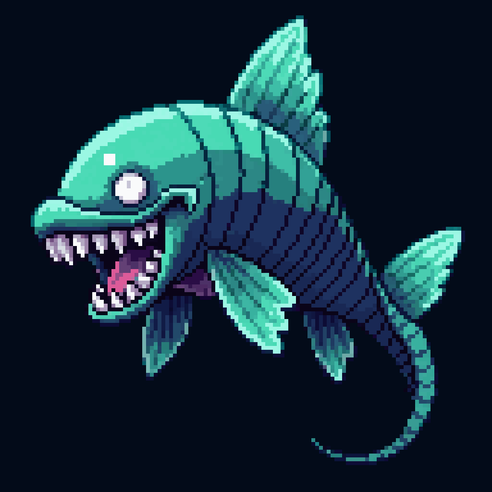

<p align="center">
  
</p>

<h1 align="center">ABYSM</h1>

<p align="center"><em>A dive to the bottom of the sea.</em></p>

<p align="center">
  
  
  
  
  
</p>

---

**ABYSM** is a calm, free-swim deep-sea exploration game. Sink from the sunlit surface all the way down to the bottom of the ocean — the 10,935 m **Challenger Deep** — meeting the real creatures that live at each depth along the way.

No goals. No timers. No combat. Just you, a headlamp, and the slow weightless drift into the dark.

> Put on headphones, turn the lights down, and descend.

## 🌊 The descent

The ocean is built to scale, from the warm shallows to the crushing trench floor. Each zone gets darker, colder, and stranger than the last.

| Zone | Depth | What it feels like |
|------|-------|--------------------|
| ☀️ Sunlight Zone | 0 – 200 m | Warm, bright, full of life |
| 🌫️ Twilight Zone | 200 – 1,000 m | Fading blue gloom, lit by living glow |
| 🌑 Midnight Zone | 1,000 – 4,000 m | Eternal black, near-freezing |
| 🕳️ The Abyss | 4,000 – 6,000 m | Pitch-black plains, immense pressure |
| ⚫ Hadal Zone | 6,000 – 10,935 m | The deepest trenches — barely alive |

## ✨ Features

- **75 real sea creatures** placed at their true depths, each with a one-line fact — from the manatee in the shallows to the anglerfish, giant squid, and the hadal snailfish at the very bottom.
- **8 real ocean landmarks** to find on the way down, including the **RMS Titanic** (3,800 m), the **USS Johnston** (6,241 m), and the **Challenger Deep** (10,935 m).
- **A living headlamp** that carves a glowing circle out of the darkening deep.
- **Breach the surface** like a dolphin, then sink back into the blue.
- Original **pixel art**, procedurally generated **ambient audio**, and gentle **haptics**.
- Full **game-controller** support, or a simple on-screen joystick.
- Playable in **16 languages**.

## 🎮 Controls

**Touch**

- Bottom-left **joystick** to swim.
- Bottom-right action diamond — **▲ rise to surface · ▼ headlamp · ◀ boost · ▶ turbo**.
- Top-left **pause**, top-right **mute**.

**Game controller**

| Input | Action |
|-------|--------|
| Left stick / D-pad | Swim |
| A | Toggle headlamp |
| B | Turbo |
| X | Boost |
| Y | Rise to surface |
| Menu | Pause |
| L1 | Mute |

## 🌍 Languages

English · Spanish · French · German · Italian · Brazilian Portuguese · Russian · Polish · Dutch · Turkish · Hindi · Japanese · Korean · Simplified Chinese · Traditional Chinese · Arabic

All text lives in a single `Localizable.xcstrings` String Catalog. Latin-script languages keep the retro pixel font; other scripts (CJK, Cyrillic, Devanagari, Arabic) fall back to a glyph-complete system font so everything renders and shapes correctly.

## 🛠️ Built with

- **Swift** + **SpriteKit** — the whole game is a handful of `SKScene`s and nodes.
- **GameController** — MFi / Xbox / PlayStation controller support.
- **AVFoundation** — looping, depth-mixed generated ambience.
- **Core Haptics** — controller + device rumble for key moments.
- **String Catalogs** — 16-language localization.
- Procedural pixel textures and dithered depth gradients, no giant pre-baked art.

## 🚀 Build & run

1. Open `Abysm.xcodeproj` in Xcode.
2. Select the **Abysm** scheme.
3. Run on an iOS **17+** device or simulator (landscape).

The only dependency is the **RevenueCat** Swift package (`purchases-ios-spm`), which Xcode resolves automatically via Swift Package Manager on first open — no manual setup.

### Website

The static landing page in `web/` is hosted on Cloudflare Workers. With Wrangler authenticated, build and deploy it from the repository root:

```sh
cd web
npm run build
npx wrangler deploy
```

### Releases

Version tags beginning with `v` drive both release systems. Create and push an annotated tag only when that version is ready to ship:

```sh
git tag -a v1.0.0 -m "ABYSM 1.0.0"
git push origin v1.0.0
```

The tag starts the Xcode Cloud App Store archive and the GitHub Actions workflow that creates a GitHub Release with generated release notes. Tags containing a suffix, such as `v1.1.0-beta.1`, create a GitHub prerelease.

## 🔗 Links & support

- **Website:** [abysm.apoorvdarshan.com](https://abysm.apoorvdarshan.com/)
- **App Store / rate ABYSM:** [apps.apple.com/app/id6783505799](https://apps.apple.com/app/id6783505799)
- **Privacy:** [abysm.apoorvdarshan.com/#privacy](https://abysm.apoorvdarshan.com/#privacy)
- **Terms:** [abysm.apoorvdarshan.com/#terms](https://abysm.apoorvdarshan.com/#terms)
- **Email support:** [ad13dtu@gmail.com](mailto:ad13dtu@gmail.com?subject=ABYSM%20Support)
- **Email Apoorv:** [apoorvdarshan@gmail.com](mailto:apoorvdarshan@gmail.com?subject=ABYSM%20Support)
- **X:** [@apoorvdarshan](https://x.com/apoorvdarshan)
- **Instagram:** [@apoorvgames](https://www.instagram.com/apoorvgames/)
- **Product Hunt:** Upvote link coming soon.

## 🔒 Privacy

ABYSM has no account, no login, no ads, and no advertising or cross-app tracking. Your current dive's depth and position, sound preference, and cached unlock state are stored locally on your device (via `UserDefaults`). The app follows the language selected in iOS and does not store a separate language preference. **RevenueCat** is contacted at launch and for purchase or restore operations; it receives an anonymous app-user ID, purchase and entitlement information, and basic technical information needed to provide and validate "Unlock the Deep." This information is not used for advertising or cross-app tracking. See [RevenueCat's privacy policy](https://www.revenuecat.com/privacy-policy/) for its processing details.

App Store privacy label: **Purchases** (Purchase History) — not linked to your identity, not used for tracking.

## 📜 License

© Apoorv Darshan. All rights reserved.

---

<p align="center"><sub>Made with ☕ and an unreasonable fondness for anglerfish.</sub></p>
